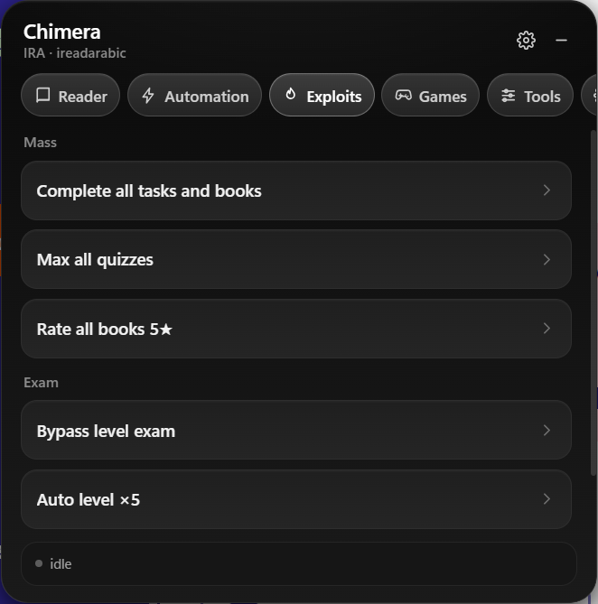

# ChimeraIRA

ChimeraIRA is a browser userscript cheat for [ireadarabic.com](https://www.ireadarabic.com). It adds a floating control panel that handles reading, book tasks, quizzes, level progression, and games from one place.

<p align="center">
  
</p>

## What it does

**Reader**
- Auto-read through a book and flip pages.
- Warp to the last page.
- Instant-complete the current book.
- Jump straight to listen mode or the quiz.

**Automation**
- Complete the current book.
- Complete the next unfinished book.
- Run quiz-only completion.

**Exploits**
- Complete every task and book in the current level.
- Max all quizzes.
- Rate every book 5★.
- Bypass the level exam.
- Auto level ×5.
- Skip all levels to max.
- Unlock and rate games.

**Games**
- Unlock every game.
- Unlock the current game.
- Rate all games 5★.
- Open a random unlocked game.

**Tools and session**
- Copy the current quiz injection URL.
- Quick links to dashboard, books, reports, assignments, and the open library.
- Copy the captured session token.
- Reading gate, auto-rate, notifications, instant mode, and concurrency settings.

## Install

1. Install [Tampermonkey](https://www.tampermonkey.net/) or [Violentmonkey](https://violentmonkey.github.io/).
2. Install the userscript:

```text
https://raw.githubusercontent.com/lolcaken/ChimeraIRA/main/dist/chimera-ira.user.js
```

## Usage

Open any page on `ireadarabic.com`. The panel appears in the bottom-right corner. Drag it by the header, collapse it with the minus button, or open Settings from the Misc tab.

Tabs: **Reader · Automation · Exploits · Games · Tools · Misc**

## Source

The automation core is closed source. Non-core runtime pieces are published in [`open/`](open/), including settings, token capture, toast notifications, and reader navigation.
